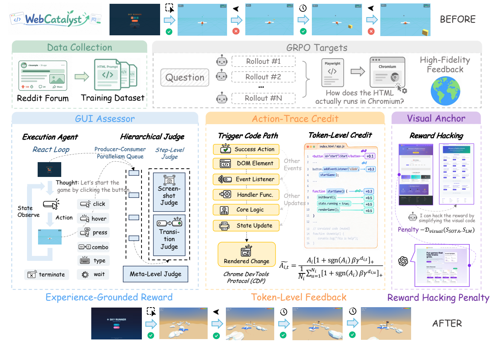
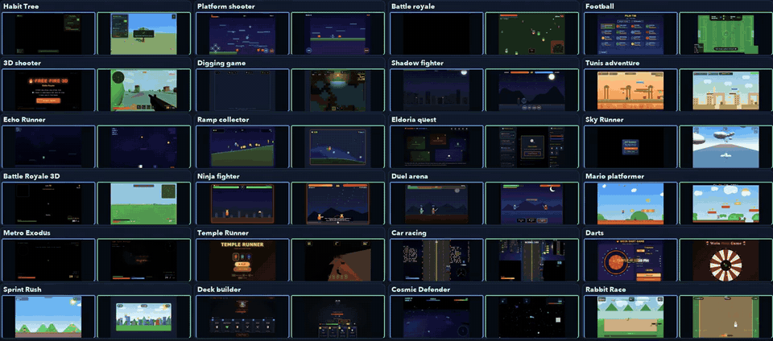

<h1 align="center">WebCatalyst</h1>
<h3 align="center">Catalyzing Interactive HTML Generation Capabilities<br>via High-Fidelity Reinforcement Learning</h3>

<p align="center">
  <a href="https://klozewang.github.io/webcatalyst-project-page/"></a>
  <a href="https://arxiv.org/abs/2611.05151"></a>
  <a href="#method"></a>
  <a href="#interactive-demo"></a>
  <a href="https://raw.githubusercontent.com/klozewang/webcatalyst/main/logs/WebCatalyst%20Training%20Logs.zip"></a>
  <a href="agens-cli/README.md"></a>
  <a href="LICENSE"></a>
</p>

<p align="center">
  <a href="#overview">Overview</a> ·
  <a href="#method">Method</a> ·
  <a href="#getting-started">Getting Started</a> ·
  <a href="#prepare-visual-anchors">Visual Anchors</a> ·
  <a href="#training">Training</a> ·
  <a href="#interactive-demo">Demo</a>
</p>

## Overview

WebCatalyst trains code language models to generate functional and visually coherent HTML applications through browser interaction, visual feedback, and execution traces. This repository contains the verl-based training implementation, the Agens browser simulation and reward CLI, reference preparation tools, training data, and an interactive comparison demo.

<p align="center">
  
</p>

<p align="center">
  
</p>

<p align="center">
  <a href="https://klozewang.github.io/webcatalyst-project-page/#video">▶ Watch the full explainer video</a>
</p>

## Method

WebCatalyst extends GRPO with three components:

- **GUI Assessor:** executes generated pages in Chromium and evaluates their behavior over an interaction trajectory.
- **Visual Anchor:** compares rollouts with reference screenshots and penalizes visual degradation.
- **Action-Trace Credit (ATC):** maps successful browser actions to JavaScript token spans for finer-grained credit assignment.

The GUI reward and visual penalty are combined as:

```text
r = (R_GUI - D_visual) / 100
```

After group-relative normalization, ATC adjusts token advantages using traced call-stack depth while preserving each response's mean advantage. Missing traces or failed source alignment fall back to the standard uniform response advantage.

Implementation: [reward](verl/utils/reward_score/agens_sim_reward.py), [reference selection](verl/utils/reward_score/agens_pre_rollout.py), and [ATC](verl/trainer/ppo/v1/agens_trace_advantage.py).

## Getting Started

For the shortest end-to-end workflow, see [QUICKSTART.md](QUICKSTART.md). Run the commands below from the repository root.

### Environment

Pull the prebuilt runtime from Docker Hub:

```bash
docker pull klozewang/agens-verl:0805-qwen36
export WEBCATALYST_IMAGE="klozewang/agens-verl:0805-qwen36"
```

NVIDIA GB-series GPUs require `flash-linear-attention` and `fla-core` 0.5.2. For B200, GB200, and other GB-series systems, build the supplied Dockerfile with the version override:

```bash
docker build \
  -f docker/Dockerfile.agens.qwen3_6.megatron.vllm \
  --build-arg FLASH_LINEAR_ATTENTION_VERSION=0.5.2 \
  -t webcatalyst:megatron-vllm .

export WEBCATALYST_IMAGE="webcatalyst:megatron-vllm"
```

Start the selected image:

```bash
docker run --gpus all --ipc=host -it --rm \
  -v "$PWD":/workspace/webcatalyst \
  -v "$HOME/.cache/huggingface":/root/.cache/huggingface \
  -e AGENS_ROOT=/workspace/webcatalyst/agens-cli \
  -w /workspace/webcatalyst \
  "$WEBCATALYST_IMAGE" bash
```

Install the mounted repository and build Agens inside the container:

```bash
uv pip install --python "$VIRTUAL_ENV/bin/python" --no-deps -e .
npm ci --prefix agens-cli
npm run build --prefix agens-cli
export AGENS_ROOT="$PWD/agens-cli"
```

Agens requires Node.js 24 or later. Full-run MP4 recording also requires `ffmpeg`.

### Configuration

Create the gitignored configuration file:

```bash
cp .env.example .env
```

Set your endpoint, credentials, models, and local paths:

```bash
export AGENS_SIM_JUDGE_BASE_URL="https://your-provider.example/v1"
export AGENS_SIM_JUDGE_API_KEY="YOUR_JUDGE_API_KEY"
export AGENS_SIM_JUDGE_MODEL="gpt-5.6-terra"
export AGENS_SIM_EXTRA_GLOBAL_JUDGE_MODEL="gpt-5.6-terra"
export AGENS_SIM_JUDGE_WIRE_API="responses"
export AGENS_SIM_JUDGE_DISABLE_TEMPERATURE=true

export MODEL_PATH="Qwen/Qwen3.6-35B-A3B"
export MOUNT_ROOT="/workspace/webcatalyst/run_artifacts"
export TRAINER_LOGGER='["console"]'
```

Use `AGENS_SIM_JUDGE_WIRE_API=completions` for a Chat Completions endpoint. Add `WANDB_API_KEY` and use `TRAINER_LOGGER='["console","wandb"]'` to enable W&B; set `HF_TOKEN` when model access requires it.

`run_b200.sh` and `inference/run_b200_inference.sh` load the root `.env` and require `AGENS_SIM_JUDGE_BASE_URL`; neither includes a built-in endpoint. Values in `.env` take precedence over the same shell variables. Standalone Agens commands require loading the file first:

```bash
source .env
node agens-cli/dist/cli.js config show
```

## Agens CLI

Agens CLI is the browser interaction and evaluation toolkit used by WebCatalyst. It can build or load HTML artifacts, operate them in Chromium, assess visual and functional behavior, and collect execution traces for training and analysis.

Training uses `simulate-reward` to execute generated HTML and save the reward, screenshots, evaluations, and runtime traces:

```bash
node agens-cli/dist/cli.js simulate-reward \
  --html-file /absolute/path/to/index.html \
  --task "The original user request" \
  --out-root "$PWD/run_artifacts/agens-smoke" \
  --global-step smoke --prompt-id 000000 --sample-id 0 \
  --turn-limit 8 --json
```

See the [Agens configuration guide](agens-cli/README.md#configure-your-endpoint) for provider settings and other commands.

## Prepare Visual Anchors

The bundled training and validation datasets contain **2,221** and **15** prompts. Visual Anchors can come from the paper's reference bundle or a locally generated reference run.

### Use the paper references

The reported experiment uses GPT-5.5-generated reference HTML:

```bash
mkdir -p inference/results/paper_bundle
curl -fL --retry 3 \
  <ZIP_TO_BE_UPLOADED> \
  -o inference/results/inference_gpt55.zip
python3 -m zipfile -e \
  inference/results/inference_gpt55.zip \
  inference/results/paper_bundle
```

Set `PRE_ROLLOUT_RESULTS_ROOT` to the extracted directory containing `state/run-config-*.json` and `agens/`.

### Generate local references

```bash
AGENS_TURN_LIMIT=8 \
  bash inference/run_b200_inference.sh \
  agens_data/train_game.jsonl \
  "$PWD/inference/results/train_qwen_prerl"

export PRE_ROLLOUT_RESULTS_ROOT="$PWD/inference/results/train_qwen_prerl"
```

Resume an interrupted run by adding `RESUME=1` with the same dataset, model, output directory, and settings.

### Validate references

```bash
python3 scripts/validate_agens_pre_rollouts.py \
  --dataset agens_data/train_game.jsonl \
  --results-root "$PRE_ROLLOUT_RESULTS_ROOT"
```

Keep each reference root paired with the dataset used to create it.

## Training

After configuring the judge and validating the Visual Anchors:

```bash
: "${PRE_ROLLOUT_RESULTS_ROOT:?Select a validated Visual Anchor root first.}"
export EXPERIMENT_NAME="webcatalyst_qwen36_gpt55_atc"
export MOUNT_ROOT="$PWD/run_artifacts"

bash run_b200.sh trainer.total_training_steps=40
```

The launcher requires at least eight visible GPUs. Environment variables configure common options, while extra arguments are forwarded as Hydra overrides:

```bash
AGENS_TURN_LIMIT=8 REWARD_NUM_WORKERS=6 ACTOR_LR=1e-6 \
  bash run_b200.sh \
  trainer.total_training_steps=40 \
  actor_rollout_ref.rollout.temperature=1.0
```

Resume the newest complete checkpoint under `results/` with:

```bash
bash run_b200_resume.sh trainer.total_training_steps=40
```

Set `RESUME_RESULTS_ROOT` when checkpoints are stored elsewhere.

See the [training launcher](examples/grpo_trainer/run_agens_sim_reward_qwen3_6_35b_a3b.sh) for the full training configuration.

## Training Logs

[Download the WebCatalyst training logs](https://raw.githubusercontent.com/klozewang/webcatalyst/main/logs/WebCatalyst%20Training%20Logs.zip). The archive contains the released training curves for GUI reward, transition and screenshot scores, Visual Anchor penalties, and ATC token coverage.

## Interactive Demo

[`demo/`](demo/) contains generated HTML for **100 test game prompts** from WebCatalyst and five comparison models. Start the read-only viewer with Python 3.9 or later:

```bash
python3 demo/server.py
```

Open [http://127.0.0.1:8765](http://127.0.0.1:8765) to search prompts and play two generated games side by side. See [demo/README.md](demo/README.md) for viewer options.

## Repository Layout

```text
agens-cli/              Browser interaction, evaluation, and tracing
agens_data/             Training and validation prompts
assets/                 Project figures
demo/                   Generated games and comparison viewer
docker/                 GPU runtime definitions
examples/grpo_trainer/  Training launcher
inference/              Visual Anchor generation and evaluation
scripts/                Dataset and reference validation tools
verl/                   Training framework and WebCatalyst integration
```

## Acknowledgments and License

WebCatalyst builds on [verl](https://github.com/verl-project/verl), Megatron-Core, vLLM, Playwright, and the GitHub Copilot SDK. The repository uses the [Apache-2.0 license](LICENSE).

## Citation

If you find WebCatalyst useful, please cite:

```bibtex
@misc{wang2026catalyzinginteractivehtmlgeneration,
  title        = {Catalyzing Interactive HTML Generation Capabilities via High-Fidelity Reinforcement Learning},
  author       = {Xujia Wang and Yixuan Liu and Shaohan Huang and Furu Wei and Lei Hou and Bin Xu and Juanzi Li},
  year         = {2026},
  eprint       = {2611.05151},
  archivePrefix = {arXiv},
  primaryClass = {cs.AI},
  url          = {https://arxiv.org/abs/2611.05151}
}
```

> This repository is under development. Please stay tuned.
